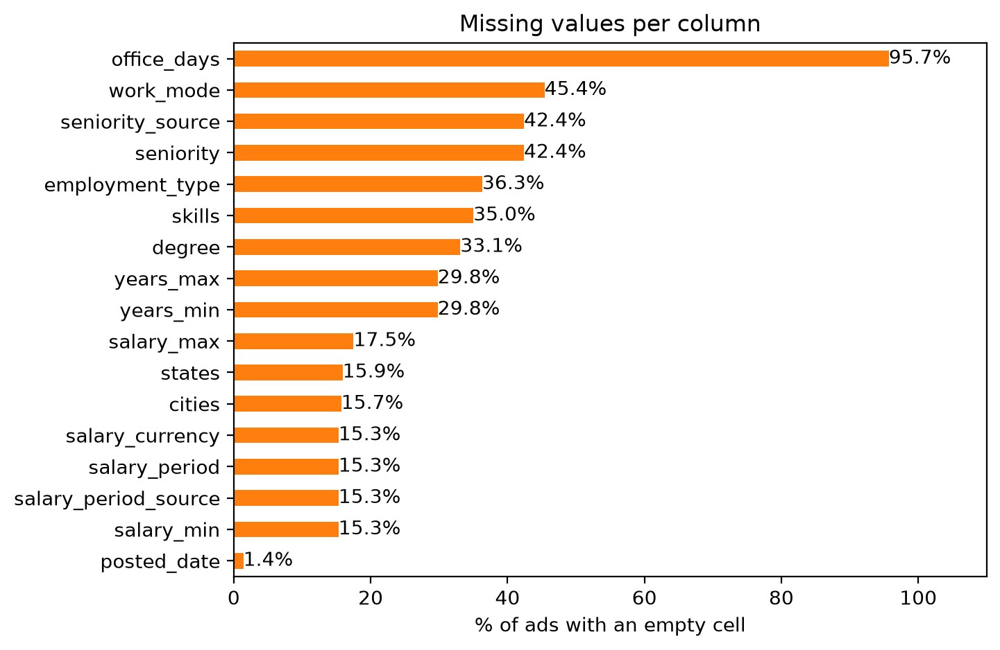
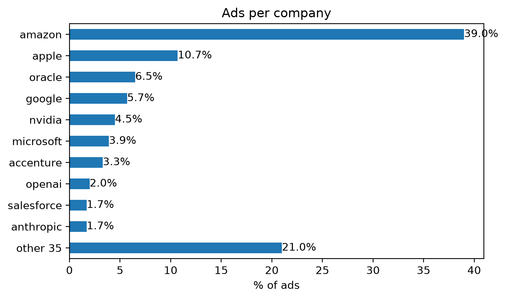
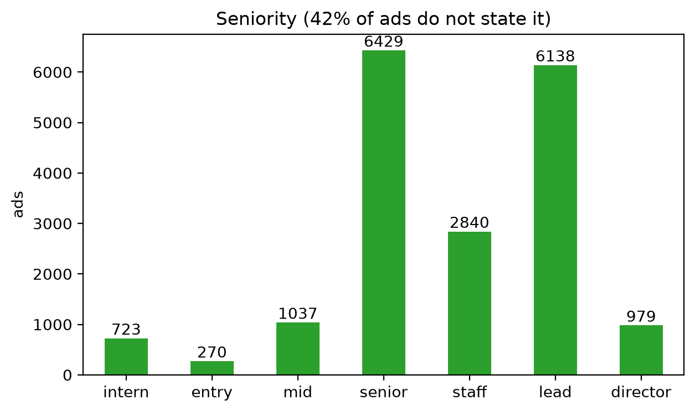
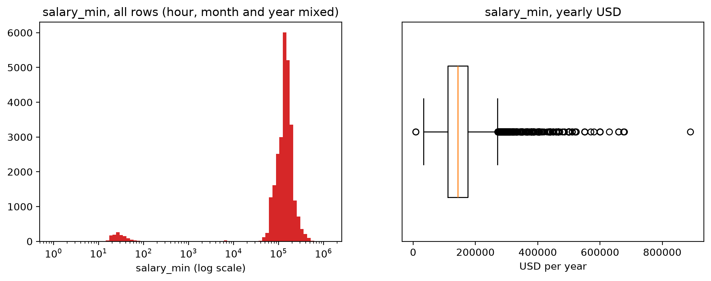

# Salary prediction from US job ads

Predicting the **yearly salary (USD)** offered in a US job ad from the ad itself: title, seniority,
role, location, work mode, years of experience and degree asked, skills, company and its industry.

The dataset is built from scratch: job ads are collected directly from the official careers sites
of 45 companies. Many US states require job ads to state a pay range (California, Washington,
New York, Colorado and others), so US ads give both the features and the target.


## Pipeline

```
companies.toml ────crawl.py──▶ data/raw/<company>.jsonl.gz ──────extract.py─────▶ data/intermediate/jobs.csv
  (sources)       (1) collect                              (2) fields from text, US only
```

```
data/intermediate/jobs.csv ──measuring_data.ipynb──▶ tables + docs/figures/*.png      (3) measure, nothing is changed

data/intermediate/jobs.csv ──clean.py──▶ jobs_clean.csv ──integrate.py──▶ jobs_integrated.csv ──transform.py──▶ train_transformed.csv + test_transformed.csv ──reduce.py──▶ data/processed/train.csv + test.csv ──▶ model
```

Each step reads the previous step's files and writes new ones; collected data is never edited.
If an extraction rule turns out to be wrong, it is fixed in the rules and `extract.py` is run again
in seconds, without collecting again. A change in a reader (a field it did not save) needs collecting again.

| Step | Script | Does | Does not |
|---|---|---|---|
| 1 | `extraction/crawl.py` | reads every company's job list and job pages, saves the fields each reader keeps (title, full description, locations, url, date...) | extract or change the text |
| 2 | `extraction/extract.py` | keeps the US ads and turns each one into a row: seniority, role, years, degree, skills, work mode, city, US state, salary as stated | remove duplicates, convert salaries, fill missing values or remove wrong values |
| 3 | `preprocessing/measuring_data.ipynb` | measures every column by its scale, draws the plots | change the data |
| 4 | `preprocessing/clean.py` | missing values, wrong salaries, noise in titles | remove duplicates, convert salaries |
| 5 | `preprocessing/integrate.py` | duplicates, salary units, redundant columns | build the target, encode, scale |
| 6 | `preprocessing/transform.py` | builds the target and new features, splits train / test, encodes, normalizes | choose the features |
| 7 | `preprocessing/reduce.py` | keeps the features a model can learn from | change the rows |

## Data sources

Ads are read from the companies' own careers sites, through the public APIs of the hiring
platforms the companies use (one reader per platform in `extraction/readers/`):

| Platform | Companies |
|---|---|
| Workday | Salesforce, CrowdStrike, Adobe, NVIDIA, Intel, Analog Devices, Microchip, NXP, Cisco, HP, Deutsche Bank, LSEG, BorgWarner |
| Greenhouse | Anthropic, Databricks, Datadog, Airbnb, Cloudflare, DRW, Hudson River Trading, IMC, Optiver, Jump Trading, Stripe, Adyen |
| Eightfold | Microsoft, Infineon, Ericsson, Netflix |
| SmartRecruiters | Nagarro, Bosch, Continental |
| iCIMS Jibe | Keysight, Susquehanna (SIG) |
| Ashby, Lever, Oracle Cloud, Phenom, Avature, Radancy | OpenAI, Spotify, Oracle, Thales, Lenovo, ING |
| Company's own site | Amazon, Apple, Google, Atlassian, Accenture |

**How the companies were chosen.** 41 companies with at least 10 such ads are kept, plus Cloudflare,
OpenAI and Apple, whose salaries are recovered by reader fixes, and Anthropic, added by hand (see `companies.toml`). Each company's
**industry** is set by hand in `companies.toml` (10 groups, e.g. `software_internet`,
`semiconductors`, `trading`, `banking_finance`, `automotive_industrial`). In total there are 45.

**Polite collection.** Only public job listings are read (the same data any visitor sees), at most
about 4 requests per second, with a User-Agent that says what the program is, and retrying with
growing pauses when a site answers "too many requests".


## Preprocessing
### 1. Data Types

#### Categorical
##### Nominal
- title (Senior Software Engineer)
- role_family (software, hardware, data)
- cities (Austin, TX) - several values per ad
- states (CA, WA) - several values per ad
- industry (semiconductors)
- company (Amazon)
- salary_currency (USD, EUR, CAD)
- salary_period (year, hour, month)

##### Binary
- skills (Python, AWS, ...) - 43 asymmetric binary attributes: only "the ad names it" matters
- seniority_source (platform / title) - symmetric
- salary_period_source (stated / inferred) - symmetric

##### Ordinal
- seniority (intern < entry < mid < senior < staff < lead < director)
- degree (bachelor < master < phd)
- work_mode (remote < hybrid < onsite) - ordered by days in the office
- employment_type (contract < part-time < full-time)

#### Numerical
##### Discrete
- years_min - ratio
- years_max - ratio
- office_days - ratio
- n_locations - ratio
- description_chars - ratio
- posted_date - interval (days; the zero is arbitrary, only differences make sense)

##### Continuous
- salary_min - ratio
- salary_max - ratio

#### Not measured
- job_id, url, company_name, locations, countries, salary_text, detail_error: identifiers, raw text and checks
- collected_date: one value for every row (the day of the crawl)

Which measures each scale allows:
| Scale | Measures |
|---|---|
| nominal, binary | frequency, mode |
| ordinal | + median, quartiles, min, max (positions in the order) |
| interval | + mean, range, IQR, std, skewness, kurtosis (on differences) |
| ratio | all of them; ratios ("twice as much") make sense |


### 2. Measuring Data

Notebook `preprocessing/measuring_data.ipynb`, on `data/intermediate/jobs.csv` (31,901 ads, 31 columns),
before any change. Each column gets the measures its scale allows (table above). Columns with several
values in a cell (`states`, `cities`, `skills`) are split first; their percentages are "% of ads", so they
add up to more than 100%. A mode is always shown with the share of missing values next to it.

#### Missing values

| Column | Missing | Column | Missing |
|---|---|---|---|
| office_days | 95.7% | skills | 35.0% |
| work_mode | 45.4% | years_min, years_max | 29.8% |
| seniority | 42.4% | salary_max | 17.5% |
| employment_type | 36.3% | states / cities | 15.9% / 15.7% |
| degree | 33.1% | salary_min, currency, period | 15.3% |
| posted_date | 1.4% | | |



#### Nominal and binary: frequency, mode

| Column | Mode | Mode % | Distinct | Missing |
|---|---|---|---|---|
| company | amazon | 39.1% | 45 | 0% |
| industry | software_internet | 65.6% | 10 | 0% |
| role_family | other | 18.9% | 18 | 0% |
| states | CA | 29.1% | 51 | 15.9% |
| cities | Seattle, WA | 16.4% | 1,368 | 15.7% |
| title | Area Manager II | 0.7% | 23,318 | 0% |
| salary_currency | USD | 84.6% | 3 | 15.3% |
| salary_period | year | 81.0% | 3 | 15.3% |
| seniority_source | title | 57.0% | 2 | 42.4% |
| salary_period_source | stated | 56.0% | 2 | 15.3% |

`skills`: AWS is in 22.8% of the ads, Python 22.1%, Machine Learning 18.5%; 35.0% name none of the 43.



#### Ordinal: frequency, mode, median, quartiles

The median and quartiles are positions in the order, so they are always a category; a mean is not allowed.

| Column | Min | Q1 | Median | Q3 | Max | Mode | Missing |
|---|---|---|---|---|---|---|---|
| seniority | intern | senior | staff | lead | director | senior | 42.4% |
| degree | bachelor | bachelor | bachelor | bachelor | phd | bachelor | 33.1% |
| work_mode | remote | hybrid | onsite | onsite | onsite | onsite | 45.4% |
| employment_type | contract | full-time | full-time | full-time | full-time | full-time | 36.3% |



#### Numeric: mean, median, mode, midrange, range, percentiles, IQR, five-number summary, std, variance, skewness, kurtosis

The full table is in the notebook; std and variance are the sample ones, kurtosis is the excess kurtosis
(0 for a normal distribution), outliers are values outside [Q1 - 1.5 IQR, Q3 + 1.5 IQR], counted only.

| Column | Mean | Median | Min | Q1 | Q3 | Max | Std | Skewness | Kurtosis | Outliers |
|---|---|---|---|---|---|---|---|---|---|---|
| years_min | 4.73 | 4 | 0 | 2 | 7 | 20 | 3.22 | 1.04 | 1.03 | 289 |
| years_max | 6.04 | 5 | 0 | 3 | 8 | 20 | 3.42 | 0.67 | 0.16 | 83 |
| office_days | 2.62 | 3 | 0 | 3 | 3 | 5 | 1.45 | -0.74 | -0.19 | 519 |
| n_locations | 2.50 | 1 | 0 | 1 | 2 | 121 | 5.85 | 6.43 | 44.82 | 3,522 |
| description_chars | 6,210 | 5,929 | 74 | 4,666 | 7,457 | 55,750 | 2,213 | 1.59 | 17.96 | 632 |

**Salary (the target).** Measured over all rows and per pay period (USD only):

| | Count | Mean | Median | Min | P5 | Q1 | Q3 | Max | Midrange | Std | Skewness | Kurtosis | Outliers |
|---|---|---|---|---|---|---|---|---|---|---|---|---|---|
| salary_min, all rows | 27,020 | 142,468 | 142,300 | 5 | 52,000 | 102,300 | 174,000 | 890,000 | 445,003 | 66,829 | 1.2 | 5.4 | 894 |
| salary_min, year | 25,792 | 149,122 | 143,700 | 8,625 | 70,350 | 111,300 | 175,000 | 890,000 | 449,313 | 60,768 | 1.9 | 7.6 | 1,047 |
| salary_max, year | 25,273 | 230,234 | 215,250 | 49,920 | 117,100 | 182,400 | 269,080 | 1,690,000 | 869,960 | 87,671 | 2.4 | 15.2 | 933 |
| salary_min, hour | 1,156 | 31.6 | 28.1 | 5.0 | 18.0 | 22.8 | 38.0 | 196.7 | 100.9 | 14.4 | 3.8 | 30.2 | 41 |
| salary_min, month | 35 | 6,554 | 6,810 | 5,690 | 5,690 | 6,810 | 6,810 | 6,810 | 6,250 | 477 | -1.4 | -0.2 | 8 |



**posted_date (interval).** Median 2026-09-30, mean 2026-08-24, mode 2026-10-30, min 2017-11-30,
max 2026-11-05; IQR 70 days, std 138 days, skewness -7.6, kurtosis 86. 807 ads were posted before 2026.

#### What the measures show

| Finding | Goes to |
|---|---|
| Amazon is 39% of the ads (Apple 10.4%), software_internet 65%; CA and WA hold most ads | reduction (sampling) |
| `office_days` is 95.7% empty; seniority, work_mode, employment_type, degree, years 30-46% empty, because the ad does not say it (not MCAR) | cleaning: missing values |
| 15.3% of the ads have no salary, so they cannot train the model | cleaning: missing values |
| the salary mixes year, hour and month (25,827 / 1,156 / 37 rows) and USD, EUR, CAD; the mix shows at the low end (min 5, P5 52,000 against 8,625 and 70,350 for yearly) | cleaning: noise (currency), integration: inconsistencies (units) |
| yearly salary is skewed right (median 143,700 < mean 149,122, skewness 1.9) with heavy tails (kurtosis 7.6); the midrange is three times the median | transformation (log of the target) |
| not every outlier is wrong: the max ($890,000 - $1,690,000, Netflix) is stated in the ad; the min (8,625, Amazon) is a night-shift bonus | cleaning: outliers |
| `title` has 23,318 distinct values for 31,901 ads, with spelling variants; `role_family` has `other` as its mode | cleaning: noise |
| 157 rows are exact duplicates (same `job_id`); 2,597 more are the same job under another id (same company, title, salary and description length) | integration: duplicates |
| `company_name` has one value per `company`; `collected_date` has one value for all rows | integration: redundancy |
| `seniority`: `lead` (19.2%) holds mostly managers ("Area Manager II"), so its place in the order is debatable | transformation (encoding) |

### 3. Data cleaning

Script `preprocessing/clean.py`: `data/intermediate/jobs.csv` (31,901 rows) → `data/intermediate/jobs_clean.csv`
(26,971 rows). The decisions follow the findings of Measuring data.

#### Missing values

Why a value is missing decides how it is handled:
- **MCAR** (missing completely at random): the gap has nothing to do with the data;
- **MAR** (at random): it depends on other columns, e.g. on the company's platform;
- **MNAR** (not at random): it depends on the value itself, e.g. the ad does not state it.

In this dataset an empty cell almost always means "the ad does not say it" (MNAR). For some columns it
also depends on the company: some platforms never give `work_mode` (MAR). So "not stated" is
information, and it is kept, not guessed.

The method used for each column:

| Column | Missing | Method | Why |
|---|---|---|---|
| salary (target) | 4,881 rows (15.3%) | **ignore the tuple** (drop the row) | without the target, a row cannot train the model |
| salary_max | 695 rows | **fill from the same row**: `salary_max = salary_min` | the ad says "from $X", a single amount |
| seniority, work_mode, employment_type, degree, states, cities | 4,157 to 12,517 rows | **global constant** `"unknown"` | MNAR / MAR: "not stated" is a category of its own |
| office_days | 95.7% | **drop the column** | too few values to use |
| detail_error | 100% | **drop the column** | no values |
| years_min, years_max, posted_date | 29.8%, 1.4% | **attribute median**, later, in `transform.py` after the train / test split | a median over all rows would include the test rows; imputers are fitted on the training set only |
| skills | 35.0% | none | not missing: the ad names none of the 43 skills, so every skill is 0 |

Not used: filling in by hand (thousands of rows), the class mean (the class is the salary we predict), the most
probable value from a model (more complex than needed for these columns).

#### Noisy data

Noise is a random error in a value. Here it comes from the extraction rules: an amount near a pay word
that is not the salary. It can be handled by binning (smoothing by bin means, medians or boundaries),
regression, clustering, or **combined computer and human inspection**. The last one was used:
- the measures pointed to suspicious values (the min, the low percentiles, the currencies);
- each case was read by hand in `salary_text`;
- a rule removes the cases of that kind.

| Noise | Example | Rule | Rows dropped |
|---|---|---|---|
| salary in another currency | Cloudflare's Lisbon range in EUR; "AutoCAD" read as CAD | currency is not USD | 37 |
| an amount that is not pay | "Annual Recurring Revenue of $500K", "$5MM" projects, "$15k/month" compute funding | words: revenue, million, MM, funding for compute | 7 |
| below the US minimum wage | 8,625 a year: a night-shift bonus (Amazon) | < $7.25 an hour, < $15,080 a year (2,080 hours) | 2 |
| a typo read as an hourly rate | "MIN $167.00 - MAX $279,000.00" (Keysight) | hourly inferred from the amount and ≥ $100 | 3 |
| spelling variants in titles | "Sr." / "Senior", "–" / "-", double spaces | one form for spaces, dashes, Sr., Jr., Mgr | 0 (20,889 → 20,807 distinct titles) |

Binning was not used: smoothing the salary by bin means would replace every real salary with the mean
of its bin, and the target would lose exactly the detail the model has to learn.

#### Outliers

Outliers are values outside [Q1 - 1.5 IQR, Q3 + 1.5 IQR] (the whiskers of the boxplot), counted per pay
period because the units differ:

| Period | Outliers | Fences | Most of them |
|---|---|---|---|
| year | 1,044 of 25,789 | [15,750, 270,550] | Anthropic 365, OpenAI 217, Netflix 145 |
| hour | 38 of 1,147 | [0, 61] | Accenture 23 |
| month | 8 of 35 | [6,810, 6,810] | IQR = 0, the rule has no meaning here |

An outlier is not always an error. Above the fence are the real ranges of the AI labs and Netflix (max
$890,000 - $1,690,000, stated in the ad); removing them would teach the model that no job pays that
much. So outliers are **counted, not removed**. The wrong low values were already removed as noise, by
the minimum wage rule, not by IQR. The skewed salary is handled later (transformation: log of the target).

#### Result

| | Rows |
|---|---|
| read | 31,901 |
| no salary | -4,881 |
| wrong salaries (noise) | -49 |
| written | **26,971** |

### 4. Data integration

Script `preprocessing/integrate.py`: `data/intermediate/jobs_clean.csv` (26,971 rows) →
`data/intermediate/jobs_integrated.csv` (25,329 rows). The dataset merges 45 sources (companies) read
through 17 hiring platforms, so this step checks what happens when the same job or the same kind of value
comes from different places.

#### Schema integration

Each platform names its fields differently (the locations are `location` + `additionalLocations` on Workday,
`location.name` on Greenhouse, ...).
They are mapped to one schema when collecting: one reader per platform in `extraction/readers/` writes the
same fields for every company. The industry, which no platform gives, is added from `companies.toml`.
Nothing is left to do here.

#### Duplicates

| Kind | How it is found | Rows dropped | Kept |
|---|---|---|---|
| exact | every column equal, same `job_id` (Accenture lists some jobs on two pages) | 150 | one copy |
| same `job_id`, different values | | 0, not the case | |
| partial: the same job under another id (a repost, or one copy per city) | same company, title, salary range and description length | 1,492 (Amazon 889, Oracle 275, Apple 127) | the latest posted |
| the same job at two companies | | not the case: every company is read from its own site | |

The description is not in the CSV, so its length stands for it. Checked on the raw texts: in 586 of the 861
partial groups the text is the same, and in the others only a city name or the order of the bullets differs.
Not duplicates: same company, title and salary with another description (another team); they are kept.

Duplicates matter for the model: copies of one job in both the training and the test set make the test
score look better than it is. The copy kept loses the cities of the dropped copies.

#### Redundancy

An attribute is redundant when another one gives it. It is found by dependencies and by correlation:
Pearson for numeric pairs, Spearman for an ordinal and a numeric one, chi-square with Cramér's V
(0 = independent, 1 = one decides the other) for nominal pairs.

| Columns | Result | Decision |
|---|---|---|
| `company_name` / `company` | one name per company (1:1) | `company_name` dropped |
| `locations` / `cities`, `states`, `countries`, `n_locations` | the four were read from `locations` | `locations` dropped |
| `collected_date` | one value for all rows | dropped |
| `industry` / `company` | Cramér's V = 1.00, the industry is set from the company | both kept: industry is a coarser level (10 groups, not 45); one is chosen at reduction |
| `salary_min` / `salary_max` | Pearson 0.88 | both kept: they make the target (the middle of the range) |
| `years_min` / `years_max` | Pearson 0.76 | both kept for now; one is chosen at reduction |
| `seniority` / `years_min` | Spearman 0.17 | not redundant (`lead` holds managers who ask for few years) |
| `seniority` / `role_family`, `seniority` / `degree`, `role_family` / `degree` | Cramér's V 0.24, 0.20, 0.21 | not redundant |

#### Inconsistencies (value conflicts)

| Conflict | Example | Decision |
|---|---|---|
| different units | the pay is per year, per hour or per month, depending on the company | converted to a year: hour × 2,080, month × 12 (1,046 rows); `salary_period` keeps the unit of the ad |
| the same value written two ways | "GB \| US" and "US \| GB" | `countries` sorted: 29 → 21 distinct values |
| different currencies | | not the case any more: the non-USD salaries were removed at cleaning |
| missing values that depend on the source | `work_mode` is never given by HRT, IMC, Infineon, Optiver, SIG; `employment_type` by Atlassian, Cloudflare, DRW, Spotify, Stripe; `states` by Apple, CrowdStrike | kept as `unknown`; counted per company |
| same field, different meaning | Amazon states one range for all US markets, others one per city; Keysight states min to midpoint; "posted" is the first post on some platforms and the last update on others | cannot be fixed from the data; written down as a limitation |
| different date formats | | not the case: dates were written as YYYY-MM-DD at extraction |

#### Result

| | Rows |
|---|---|
| read | 26,971 |
| exact duplicates | -150 |
| partial duplicates | -1,492 |
| written | **25,329** |

### 5. Data transformation

Script `preprocessing/transform.py`: `data/intermediate/jobs_integrated.csv` (25,329 rows, 26 columns) →
`data/intermediate/train_transformed.csv` (20,263 rows) and `test_transformed.csv` (5,066 rows), 199 columns.
Every column a model uses is now a number.

#### Train / test split

Normalization and imputation learn values from the data (a mean, a min, a median). If they are learned on
all rows, the test rows leak into the training. So the rows are split first, 80% train and 20% test, at
random (seed 42). Every value is then learned on train and applied to both. The split happens after
integration, so copies of one job cannot end up on both sides.

#### Smoothing

Done at cleaning (noisy data). Not repeated here.

#### Attribute (feature) construction

| New column | Built from | Why |
|---|---|---|
| `salary` | (`salary_min` + `salary_max`) / 2, yearly USD | the target: one number per ad |
| `log_salary` | log(`salary`) | the salary is skewed right; skewness 2.00 → -0.43 |
| `days_old` | crawl day (2026-11-05) - `posted_date`, in days | a date is an interval value; its age in days is a ratio value a model can use |
| `n_skills` | number of skills in `skills` | how technical the ad is |
| `<col>_missing` | 1 where the value was missing, 0 otherwise | keeps "the ad does not say it" after the gap is filled (see below) |

Already built at extraction, from the title and the description: `seniority`, `role_family`, `years_*`,
`degree`, `skills`, `work_mode`.

#### Aggregation

Not the case. One row is one ad, and the model predicts one ad. The aggregation that fits here (the mean
salary of each company, used as a feature) is computed from the target, so it leaks the answer into the
features. It is not used.

#### Generalization

`industry` is a generalization of `company` (10 groups instead of 45), set by hand. Both are encoded; the
choice between them is made at reduction. Concept hierarchies: see Data discretization.

#### Encoding

| Kind | Columns | How | Result |
|---|---|---|---|
| ordinal encoding | seniority, degree, work_mode, employment_type | position in the order (intern = 0 ... director = 6) | 4 columns |
| one-hot | company, industry, role_family | one 0/1 column per value | 45 + 10 + 18 columns |
| multi-hot | skills, states (several values per ad) | one 0/1 column per value; an ad can have several 1s | 43 + 52 columns (`state_unknown` included) |
| label encoding of nominal columns | | not used: a number per company (amazon = 0, apple = 1) invents an order that does not exist | |
| not encoded | title (20,807 values), cities (1,368) | too many values for one column each; their content is already in role_family, seniority and states | left as text |

#### Missing values left from cleaning

The values that were not filled at cleaning are filled here, with the **train median**. The `lower`
median is used, so the value is one that exists (a category, for an ordinal). A 0/1 column `<col>_missing`
records where a value was filled.

| Column | Train rows filled | With |
|---|---|---|
| seniority (unknown) | 7,630 | staff |
| degree (unknown) | 5,596 | bachelor |
| work_mode (unknown) | 9,458 | onsite |
| employment_type (unknown) | 7,492 | full-time |
| years_min / years_max | 5,644 | 5 / 6 |
| days_old | 108 | 31 days |

#### Normalization

Columns with different ranges (years 0-20, ads up to 121 locations) would weigh differently in models
that use distances or gradients (k-NN, linear regression, neural networks).

| Method | Formula | Columns | Result |
|---|---|---|---|
| min-max | (x - min) / (max - min) | the 4 ordinal codes | values in [0, 1] |
| z-score | (x - mean) / std | years_min, years_max, days_old, n_locations, n_skills | train: mean 0, std 1; test: mean within ±0.02, std 1.00-1.02 |
| log, before z-score | log(1 + x) | days_old, n_locations (a long right tail: posted_date had skewness -7.6, so its age +7.6; n_locations 6.4) | the long tail is pulled in |
| decimal scaling | x / 10^j | not used | it only moves the decimal point: the values are not centered, and the outliers stay as far out |
| none | | the 0/1 columns | already in [0, 1] |

The target is not normalized. The model learns `log_salary`, and its prediction is turned back into
dollars with exp.

#### Result

| | Train | Test |
|---|---|---|
| rows | 20,263 | 5,066 |
| columns | 199 | 199 |

The columns that are not used as features (`job_id`, `url`, `title`, `cities`, `salary_text`, `salary_min`,
`salary_period`, ...) are still in the files; they are chosen between at reduction.

### 6. Data reduction

Script `preprocessing/reduce.py`: `train_transformed.csv` / `test_transformed.csv` (199 columns) →
`data/processed/train.csv` (20,263 rows) and `test.csv` (5,066 rows). Each file has `job_id`, 161 features
and the target (`salary`, `log_salary`). Every decision is taken on train and applied to both files the same way.

#### Dimensionality reduction: attribute subset selection

Four filters, one after the other (184 → 161 features):

| Filter | Rule | Dropped |
|---|---|---|
| not a feature | identifiers and checks: `url`, `title`, `cities`, `salary_text`, `seniority_source`, `salary_period_source`, `description_chars` | 7 |
| | the target before it was built: `salary_min`, `salary_max` | 2 |
| | one value: `salary_currency` (all USD) | 1 |
| | **leakage**: `salary_period` is known only from the salary, not from a new ad | 1 |
| | almost one value: `countries` (99% "US") | 1 |
| low variance | a 0/1 column with fewer than 20 ones in train: too rare to learn from | 18: 9 companies (Atlassian, Stripe, Spotify, ...), 8 states (AK, HI, WY, ...), `industry_telecom` |
| redundancy | of two columns with \|Pearson\| > 0.95 in train, the second is dropped | 5: `industry_it_services` (= Accenture, 0.992), `industry_media_entertainment` (= Netflix, 0.961), `industry_aerospace_defense` (= Thales, 1.000), `years_max_missing` (= `years_min_missing`, 1.000), `days_old_missing` (= Lenovo, which gives no posting date, 0.957) |
| relevance | correlation of each feature with `log_salary` in train | none, only printed |

The 9 rare companies are not lost: their industry columns stay. This is why `industry` is kept next to
`company` (integration: Cramér's V = 1). For the frequent companies it repeats them, for the rare ones it
replaces them.

Relevance, strongest in train: `years_max` 0.40, `years_min` 0.36, `state_CA` 0.29, `company_amazon`
-0.26, `company_anthropic` 0.26, `skill_Machine Learning` 0.25, `company_openai` 0.23. 25 features have
\|r\| < 0.01. They are kept: a correlation with the target only sees one feature at a time, and misses what a
feature does together with others (a tree model can use them). Stepwise selection and decision-tree
induction need a model; they belong to the modelling phase.

#### Dimensionality reduction: PCA

PCA on the standardized features of train, computed with SVD:

| Variance kept | Components needed |
|---|---|
| 80% | 82 of 161 |
| 90% | 105 of 161 |
| 95% | 121 of 161 |

The first component explains 10.1% of the variance, the next ones 3.4% and 3.2%. There is no small number
of directions that holds the data: most features are 0/1 columns that are almost independent. To keep 95%,
PCA saves a quarter of the columns, and the features lose their meaning ("component 7" instead of
"company_amazon"). **PCA is not applied.** It can be tried for the linear models in the modelling phase,
fitted on train.

Wavelet transforms: not the case (they are for signals and images, not for a table of ads).

#### Numerosity reduction

| Method | Here |
|---|---|
| sampling (simple random, stratified, cluster) | not applied: Amazon is 36.9% of train, but dropping its ads would throw away real data from a dataset of 25,000 rows. The imbalance is handled when evaluating: the error is reported per company |
| parametric models (regression, log-linear) instead of the data | not the case: the rows are the training data of the model |
| histograms, clustering | not the case: the dataset fits in memory as it is |
| data compression | not the case |

#### Result

| | Train | Test |
|---|---|---|
| rows | 20,263 | 5,066 |
| features | 161 | 161 |
| columns (with `job_id` and the target) | 164 | 164 |

### 7. Data discretization

Discretization is needed only by models that work on categories. For the regressors above it is
**not needed**: trees and boosting choose their own thresholds (they discretize internally), and the
linear models, kNN and SVR use the numbers as they are.

| Where it would be worth it | What would be discretized |
|---|---|
| **Naive Bayes** (classification) | every numeric feature (years, n_locations, days_old) into bins, and the salary into bands as the class |
| **Logistic regression** (classification) | the salary into bands (e.g. 4 equal-frequency bands, one per quartile) as the class |
| **Linear / Ridge regression** (optional) | `years_min` into bins, to compare with the numeric version: bins catch an effect that is not a straight line |

**Decision: no discretization is applied.** The target stays a number and none of the models above
needs categories.

Concept hierarchies already in the data: company → industry, city → state, title → role_family.


## Models to be run and comparison

The target is a number (`log_salary`, turned back into dollars with exp), so every model below is a
**regressor**. All are trained on `data/processed/train.csv`; hyperparameters are chosen by 5-fold
cross-validation on train; `test.csv` is used once, at the end, to report the result.

| Model | Why it fits here |
|---|---|
| Baseline: the train median | the 0th-order polynomial (y = w0); every other model must beat it to be worth anything |
| Linear regression | the simplest model: one weight per feature, readable ("+X dollars for staff, for CA"), minimizes the MSE |
| Ridge regression | linear regression with an L2 penalty on the weights; needed with 161 features and many 0/1 columns that are almost redundant |
| Polynomial / basis-function regression | adds x², x³ of the numeric features (years, n_locations) to catch curves, e.g. the salary rises fast in the first years and slowly after |
| Bayesian linear regression | gives a distribution over the weights, so each prediction comes with its uncertainty, and the prior regularizes like Ridge |
| k-nearest neighbours | predicts the mean salary of the k most similar ads; a simple non-parametric reference, though weak in 161 dimensions |
| Decision tree (CART) | splits on thresholds and categories by itself (no scaling needed), captures interactions such as company × seniority, and can be read |
| Support vector regression (SVR) | the SVM for numbers: an RBF kernel gives non-linear fits and the soft margin ignores small errors; slow on 20,000 rows (O(n²)) |
| Random forest | many trees on bootstrap samples, averaged (bagging): more stable than one tree and robust to noise and outliers |
| AdaBoost | boosting: each new tree focuses on the ads the previous ones got wrong |
| Gradient boosting (XGBoost) | boosting with regularization; usually the strongest model on tables like this one |

Not used: **Naive Bayes** and **logistic regression**. Both predict a class, not a number, and the
project predicts the salary as a number.

Evaluation: **MAE** (error in dollars, robust to outliers), **RMSE** (punishes large errors), **R²**, all
on the test set and in dollars, plus the MAE per company (Amazon is 37% of the rows).
